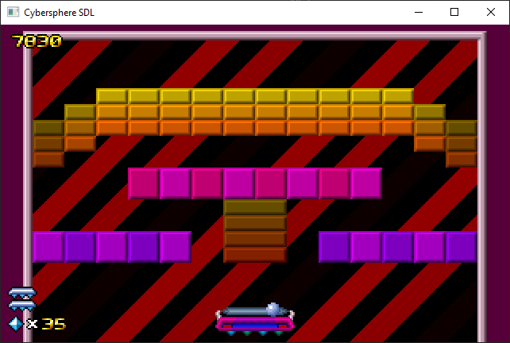

# Cybersphere SDL

**2026/11/09 — SzJoakim93**

Cybersphere SDL is an SDL port based on the MS-DOS version of **Cybersphere** and **CyberspherePlus** by Psycon Software using Ghidra and Github copilot.



## Status

* All known original gameplay features from the DOS version are working.
* Both Cybersphere and CyberspherePlus games are working
* Unlocked levels saved after closing the game too
* A separate cfg file will be created on using both game in some folder

## Usage

### Run the game

Before running the game, copy the original CYBER.EXE or CYBPLUS.EXE next to the new binary file. The original EXE functionals as asset file only. Instruction is not executed via emulation or compatibility layer.

Then start the game:

* **Windows:** Run `Cybersphere-SDL.exe`
* **Linux:** Run `./Cybersphere-SDL`

Note: If you want to use CYBER.EXE and CYBPLUS.EXE in one folder, without program arguments it starts Cybersphere. To start cyberspherePlus run Cybersphere-SDL with CYBPLUS.EXE in program argument.

### Controls

The game supports keyboard, mouse and gamepad input.

| Keyboard     | Mouse              | Gamepad              | Action                                    |
| ------------ | ------------------ | ---------------------|------------------------------------------ |
| Space        |                    | Button A             | Pause                                     |
| Left / Right | Move Left / Right  | D-pad / left stick   | Move left / right                         |
| Ctrl         | Left click         | Button X             | Launch ball / fire                        |
| Escape       |                    | Start                | Quit                                      |

> **Note:** Gamepad button names may vary depending on the device. See the SDL joystick mapping below for the exact button numbers.

## Building

### Windows

1. Clone the repository.
2. Download a 32-bit MinGW toolchain:

   * [WinLibs](https://winlibs.com/#download-release)
   * Choose the MSVCRT runtime.
   * For retro computers, use MinGW 4.7.1:
     [MinGW 4.7.1](https://sourceforge.net/projects/mingwbuilds/files/host-windows/releases/4.7.1/32-bit/threads-win32/dwarf/)

     This is the last version that supports Windows 95.
3. Extract MinGW.
4. Download the SDL 1.2 development package:
   [SDL 1.2.15 for Windows](https://libsdl.org/release/SDL-1.2.15-win32.zip)
5. Copy the `include/SDL` folder into `MinGW/include` (copy the entire `SDL` folder, not only its contents).
6. Copy the contents of the SDL `lib` directory into `MinGW/lib`.
7. Copy `bin/SDL.dll` into the bin directory of the repository.
8. Open a command prompt in the repository root.
9. Run:

```bash
mingw32-make
```

10. Start the game with:

```text
cd bin
Cybersphere-SDL.exe
```

### Linux

1. Clone the repository.
2. Install GCC if it is not already installed:

```bash
sudo apt-get update
sudo apt install gcc
```

3. Install make if it is not already installed:
```bash
sudo apt install make
```

4. Install the SDL 1.2 development libraries:

```bash
sudo apt install libsdl1.2-dev
```

5. Navigate to the repository root.
6. Build the game:

```bash
make
```

7. Run the game:

```bash
./bin/Cybersphere-SDL
```

## SDL Joystick Controls

The SDL 1.2 port uses the first connected joystick or gamepad.

The D-pad or left analog stick can be used to control movement. These inputs are mapped to the corresponding arrow-key controls.

Joystick buttons are mapped as follows:

| Button | Keyboard |
| ------ | -------- |
| 0      | Space    |
| 1      | Ctrl     |

Button numbering follows the SDL 1.2 joystick API and may vary depending on the device and driver.

## Original Game Assets

The original game assets are **not included** in this repository. You must provide them from your own copy of the original MS-DOS game.

Please do not redistribute copyrighted game assets with this project.
